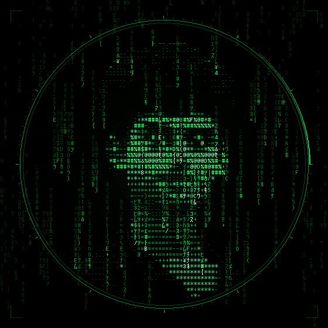
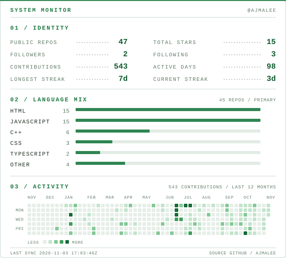

<div align="center">

<picture>
  <source media="(prefers-reduced-motion: reduce)" srcset="assets/matrix-portrait-poster.png">
  
</picture>

<h1>AJMAL ALI A</h1>

<p><code>@Ajmaleee</code> / web developer / hardware tinkerer</p>

<p>
  <a href="#selected-work">work</a> &middot;
  <a href="#system">system</a> &middot;
  <a href="https://github.com/Ajmaleee">github</a> &middot;
  <a href="https://www.instagram.com/ajmaleee__/">instagram</a> &middot;
  <a href="mailto:ajmalsworkshop@gmail.com">email</a>
</p>

</div>

```text
$ whoami
AJMAL ALI A
web developer + hardware tinkerer

I build for the browser and for the board: responsive sites,
live monitoring dashboards, and the ESP32 devices that feed them.

currently   Terra-Sential, a landslide early-warning system
building    ESP32 firmware and the dashboards that read it
```

## Selected work

### 01 / Terra-Sential
An ESP32 landslide-risk monitor with a live browser dashboard. The node, the data link, and the interface were built as one system.

`C++` `ESP32` `TypeScript`

[firmware](https://github.com/Ajmaleee/Terra-Sential) / [dashboard](https://github.com/Ajmaleee/Landslide-Detection-System---v2) / [device source](https://github.com/Ajmaleee/Landslide-Detection-System---device-source-code)

### 02 / CircuitShelf
A mobile-first inventory tracker for Arduino parts, boards, sensors, and tools. It records what works and where it lives, with a companion ESP32 location node.

`JavaScript` `ESP32` `C++`

[app](https://github.com/Ajmaleee/CircuitShelf) / [hardware](https://github.com/Ajmaleee/CircuitShelf-Hardware)

### 03 / BEEP
A keychain pet with an OLED face. You talk to it, and it responds.

`C++` `Python` `ESP32-C3`

[source](https://github.com/Ajmaleee/BEEP)

### 04 / TechBlog
Notes from the hardware side: builds, fixes, and the code that connects them.

`Astro` `CSS`

[read](https://github.com/Ajmaleee/TechBlog)

More repositories at [github.com/Ajmaleee](https://github.com/Ajmaleee?tab=repositories).

## System

<p align="center">
  <picture>
    <source media="(prefers-color-scheme: dark)" srcset="assets/generated/system-dark.svg">
    
  </picture>
</p>

<p align="center"><sub>Generated from public profile data. Updates daily.</sub></p>

## Stack

```text
LANGUAGES   JavaScript / TypeScript / HTML / CSS / Python / C++
EMBEDDED    ESP32 / Arduino / SSD1306 OLED / sensors
WEB         Astro / responsive interfaces / live dashboards
```

## Elsewhere

[GitHub](https://github.com/Ajmaleee) / [Instagram](https://www.instagram.com/ajmaleee__/) / [Email](mailto:ajmalsworkshop@gmail.com)

<sub>Portrait and system panel are generated from source in <a href="tools/">tools/</a>.</sub>
